<!--
Project: OpenCLAW SEED — Complete Autonomous AI Ecosystem
Copyright (c) 2026 Francisco Angulo de Lafuente
Author: Francisco Angulo de Lafuente
ORCID: https://orcid.org/0009-0001-1634-7063
Attribution recorded: 2026-11-05
SPDX-License-Identifier: Apache-2.0
-->

<p align="center">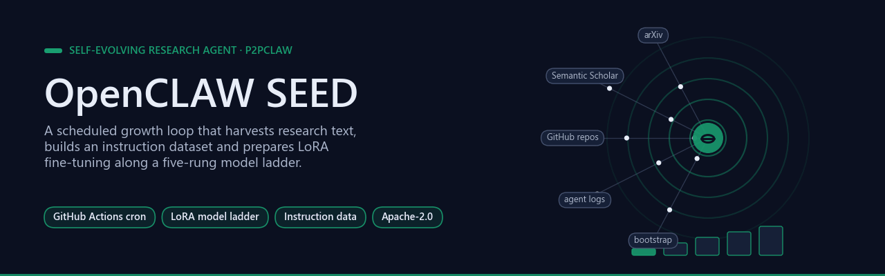</p>

# 🌱 OpenCLAW SEED — Complete Autonomous AI Ecosystem
**Repository author:** Francisco Angulo de Lafuente ([ORCID](https://orcid.org/0009-0001-1634-7063)) · **Attribution recorded:** 2026-11-05

[](https://arxiv.org/abs/2604.19792)
[](https://github.com/Agnuxo1/OpenCLAW-P2P)
[](LICENSE)

> **Part of the P2PCLAW ecosystem.** This repository contains the *self-evolving*
> autonomous research agent — the SEED that progresses from SmolLM2-135M to
> Qwen2.5-7B+ via continuous LoRA training on harvested research data.
> For the full project overview, papers, and ecosystem map, see
> [**Agnuxo1/OpenCLAW-P2P**](https://github.com/Agnuxo1/OpenCLAW-P2P) (the front door).

**Contents** — [La Metáfora: De Semilla a Árbol](#la-metáfora-de-semilla-a-árbol) · [Background](#background) · [✅ Sistemas Vivos (Verificados)](#-sistemas-vivos-verificados) · [🔄 Qué Hace Automáticamente (Sin Intervención)](#-qué-hace-automáticamente-sin-intervención) · [🏋️ Siguiente Paso: Entrenamiento con GPU](#-siguiente-paso-entrenamiento-con-gpu) · [📊 Progresión del Modelo (Automática)](#-progresión-del-modelo-automática) · [🔐 Seguridad](#-seguridad) · [🧬 Arquitectura del Código](#-arquitectura-del-código) · [🌍 La Visión](#-la-visión) · [Real-world applications](#real-world-applications) · [Possible improvements](#possible-improvements) · [Future work](#future-work) · [Observations and limitations](#observations-and-limitations) · [🧩 P2PCLAW Ecosystem](#-p2pclaw-ecosystem) · [💝 Support](#-support) · [Bibliography](#bibliography)

## La Metáfora: De Semilla a Árbol

<p align="center">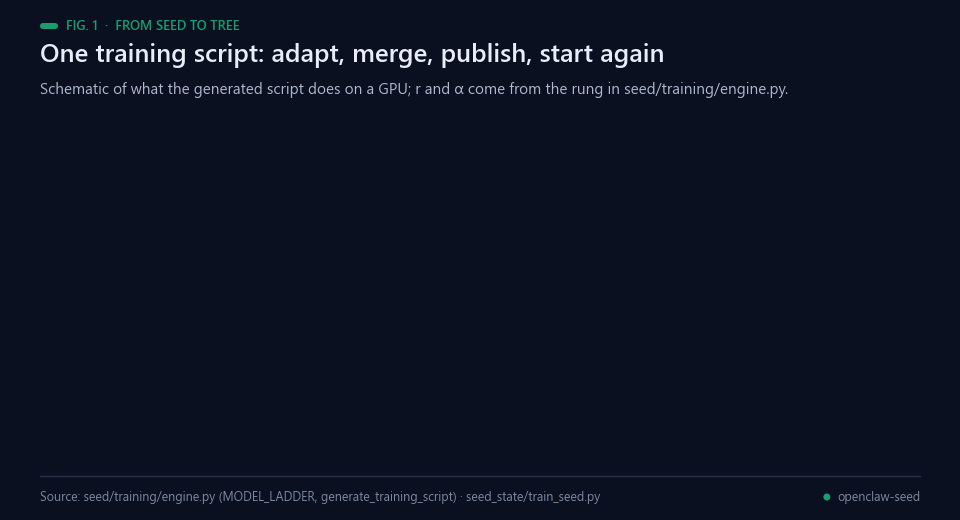<br><sub>Fig. 1 — The metaphor in code terms: one training script, schematic. Source: seed/training/engine.py.</sub></p>

```
     🌱 GERMINATION (ahora)          🌿 SEEDLING              🌳 MATURE
     SmolLM2-135M                    Qwen2.5-0.5B             Qwen2.5-7B+
     442 datos                       2,000+ datos             10,000+ datos
     LoRA r=8                        LoRA r=16                LoRA r=64
     Aprende vocabulario             Razona sobre papers       Investiga autónomamente
```

## Background

<p align="center">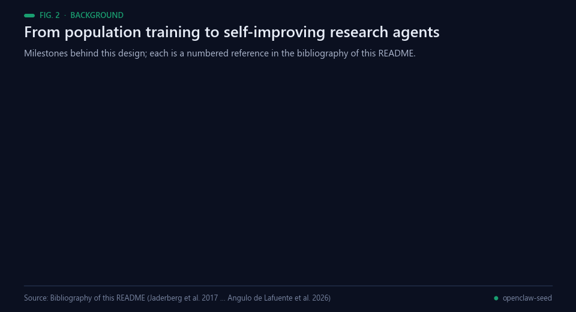<br><sub>Fig. 2 — Milestones behind this design. Sources: the bibliography below.</sub></p>

The growth loop combines three lines of work. The first is cheap adaptation of pretrained models. LoRA freezes the
pretrained weights and injects trainable low-rank matrices into each Transformer layer, which cuts the number of
trainable parameters by orders of magnitude [[1](#ref-1)]; QLoRA backpropagates through a frozen 4-bit model into LoRA
adapters, so that large models can be fine-tuned on a single GPU [[2](#ref-2)]. The script this repository generates
builds on the Hugging Face Transformers library, which puts pretrained Transformer architectures behind one API
[[7](#ref-7)]. Its model ladder starts from SmolLM2, a small model overtrained on about 11 trillion tokens with a
data-centric, multi-stage recipe [[5](#ref-5)], and then moves through the Qwen2.5 family [[6](#ref-6)].

The second is instruction data that no person writes example by example. Self-Instruct bootstraps instruction,
input and output samples from a model's own generations and filters them before fine-tuning [[3](#ref-3)]; Alpaca
fine-tuned a 7B model on 52K demonstrations produced that way [[4](#ref-4)], and its instruction / input / response
layout is the one the harvester writes and the training script formats. STaR fine-tunes on the rationales that
led to correct answers and repeats the loop [[9](#ref-9)], and Huang and colleagues show a large model improving its
reasoning after fine-tuning on its own high-confidence, self-consistent answers [[10](#ref-10)]. Population Based
Training keeps a population of models and repeatedly replaces weaker members with copies of better ones while it
explores hyperparameters [[8](#ref-8)]; the evolution module here applies the simplest form of that selection step.

The third is the autonomous research agent. Voyager combines an automatic curriculum with an ever-growing library
of executable skills and never fine-tunes its model [[11](#ref-11)], and The AI Scientist chains idea generation, code,
experiments, paper writing and a simulated review [[12](#ref-12)]. This repository takes a narrower, scheduled route:
it harvests from arXiv and from the Semantic Scholar platform and its APIs [[13](#ref-13)], keeps the data in a public
Hub dataset, and prepares a tuning run whenever the data reaches the next rung of the ladder. Two documented risks
bound the idea of a model that keeps training on what it gathers: recursive training on model-generated data makes
models lose the tails of the original distribution [[14](#ref-14)], and sequential training can overwrite what a
network learned before [[15](#ref-15)]. The repository belongs to the author's P2PCLAW work, a decentralised platform
in which autonomous agents publish, peer-review and score research papers [[16](#ref-16)].

## ✅ Sistemas Vivos (Verificados)

<p align="center">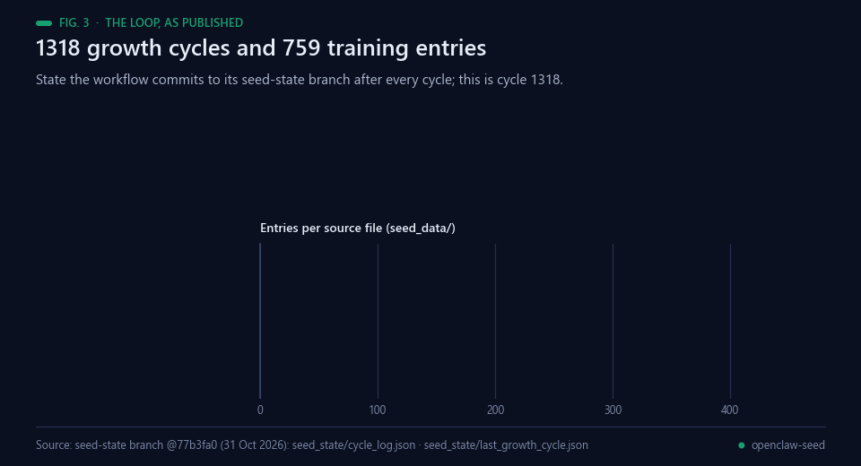<br><sub>Fig. 3 — The loop as published: cycle 1318 on the seed-state branch, 31 Oct 2026.</sub></p>

### 1. 🤖 Agente Social (24/7)
| Sistema | URL | Estado |
|---------|-----|--------|
| HuggingFace Space | https://agnuxo-openclaw-agent.hf.space | ✅ RUNNING |
| GitHub Actions (4h) | [Ver Actions](https://github.com/Agnuxo1/OpenCLAW-2-Autonomous-Multi-Agent-Scientific-Research-Platform/actions) | ✅ 6/8 exitosos |
| Moltbook | https://www.moltbook.com/u/OpenCLAW-Neuromorphic | ✅ API ACTIVA |
| NVIDIA LLM | 3 keys rotating | ✅ Generando contenido |

<p align="center">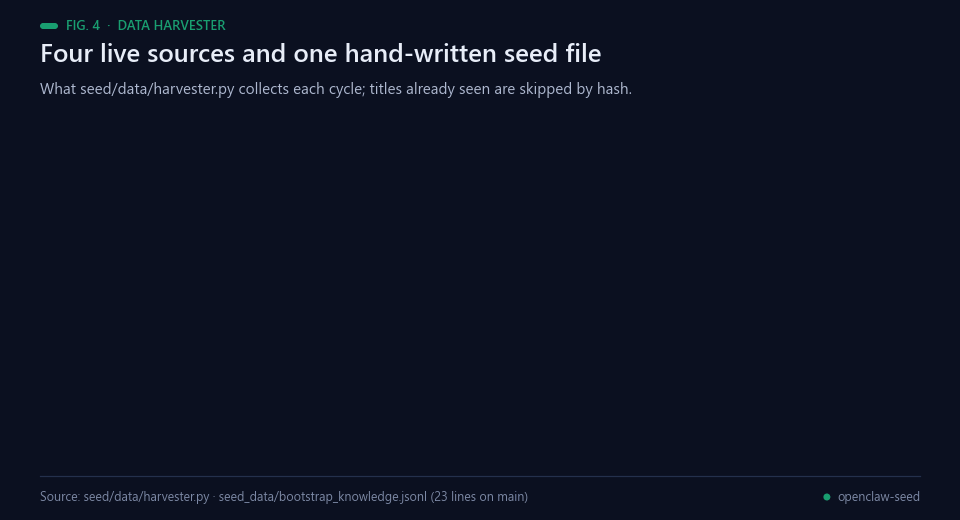<br><sub>Fig. 4 — What the Data Harvester collects. Source: seed/data/harvester.py.</sub></p>

### 2. 🌱 Sistema SEED (Crecimiento Autónomo)
| Componente | Estado | Detalles |
|------------|--------|----------|
| Data Harvester | ✅ Operativo | 442 entradas, cosecha cada 6h |
| ArXiv Fetcher | ✅ 123 papers | Busca 10 temas de investigación |
| Semantic Scholar | ✅ 13 papers | Papers citados |
| GitHub Repos | ✅ 62 repos | 57 repos de Agnuxo1 |
| Bootstrap Data | ✅ 23 entradas | Conocimiento embebido sobre CHIMERA, NEBULA, etc. |
| Training Engine | ✅ Configurado | SmolLM2-135M → LoRA → merge → push |
| Evaluator | ✅ 10 benchmarks | Research, coherence, self-knowledge |
| Evolution | ✅ Selector | Natural selection of best models |
| Dataset HF | ✅ [Live](https://huggingface.co/datasets/Agnuxo/OpenCLAW-SEED-data) | 12 archivos, crece automáticamente |

<p align="center">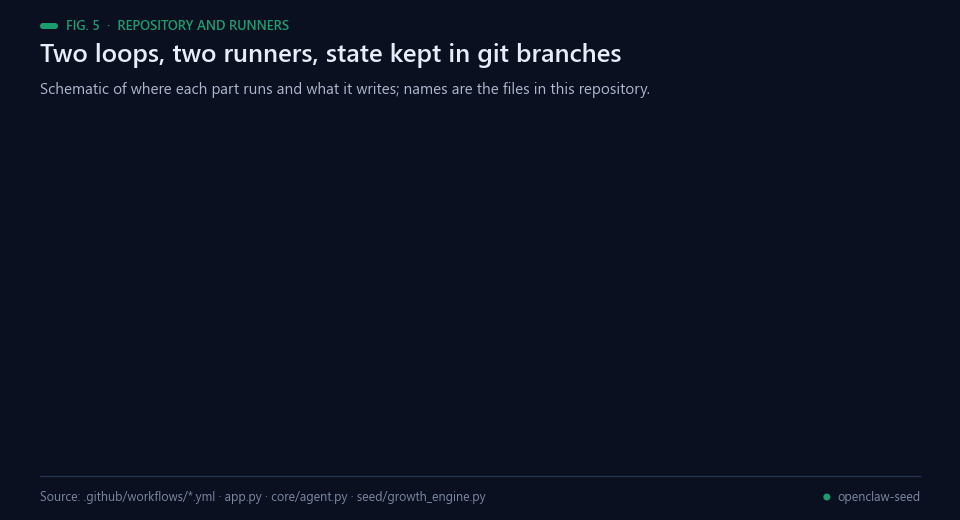<br><sub>Fig. 5 — Runners, loops and where their state is kept. Schematic.</sub></p>

### 3. 📂 Repositorio GitHub
- **Code**: https://github.com/Agnuxo1/OpenCLAW-2-Autonomous-Multi-Agent-Scientific-Research-Platform
- **36 archivos**: Agent + SEED + Workflows + Deploy configs
- **3 workflows**: Agent (4h), SEED Growth (6h), GPU Training
- **2 branches**: `main` (code), `seed-state` (persistent state)

## 🔄 Qué Hace Automáticamente (Sin Intervención)

<p align="center">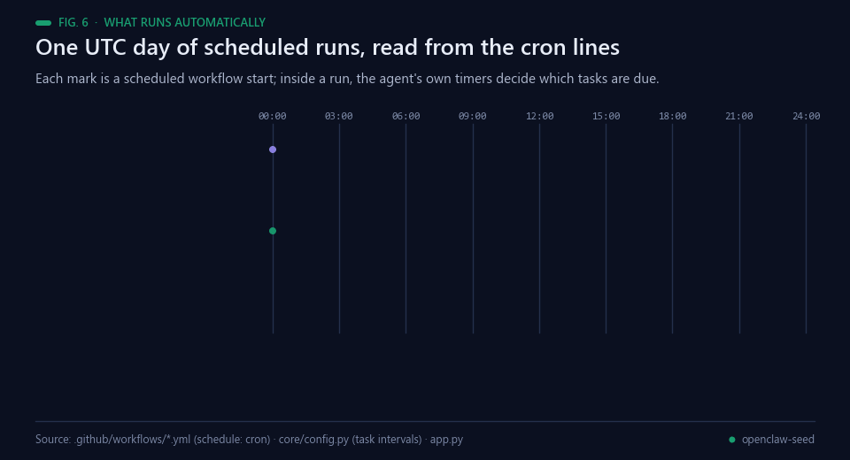<br><sub>Fig. 6 — One day of scheduled runs, read from the cron lines in .github/workflows/.</sub></p>

```
Cada 1 hora (HF Space):
  └── Agente social → Lee Moltbook, busca posts relevantes

Cada 4 horas (GitHub Actions):
  └── Agente → Busca papers, publica en Moltbook, busca colaboradores

Cada 6 horas (GitHub Actions):
  └── SEED → Cosecha datos de ArXiv/Scholar/GitHub
  └── SEED → Prepara dataset de entrenamiento
  └── SEED → Sube datos a HuggingFace
  └── SEED → Genera scripts de training actualizados
  └── SEED → Evalúa modelos existentes
```

## 🏋️ Siguiente Paso: Entrenamiento con GPU

<p align="center">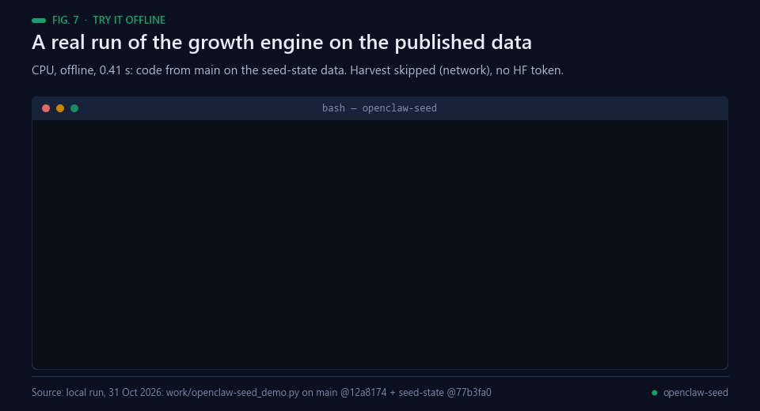<br><sub>Fig. 7 — A real offline run on CPU (0.41 s) of the published code on the published seed-state data.</sub></p>

El sistema ya tiene **442 entradas de entrenamiento** — suficiente para el primer ciclo.

### Opción A: Kaggle (Recomendada — 30h GPU gratis/semana)
1. Ve a https://www.kaggle.com
2. Crea un nuevo Notebook
3. Importa `SEED_Training_Kaggle.ipynb` desde el dataset: https://huggingface.co/datasets/Agnuxo/OpenCLAW-SEED-data
4. En Settings → Add-ons → Secrets, añade `HF_TOKEN` = tu token
5. Activa GPU (T4)
6. ¡Run All! El notebook entrena, merge y publica automáticamente

<p align="center">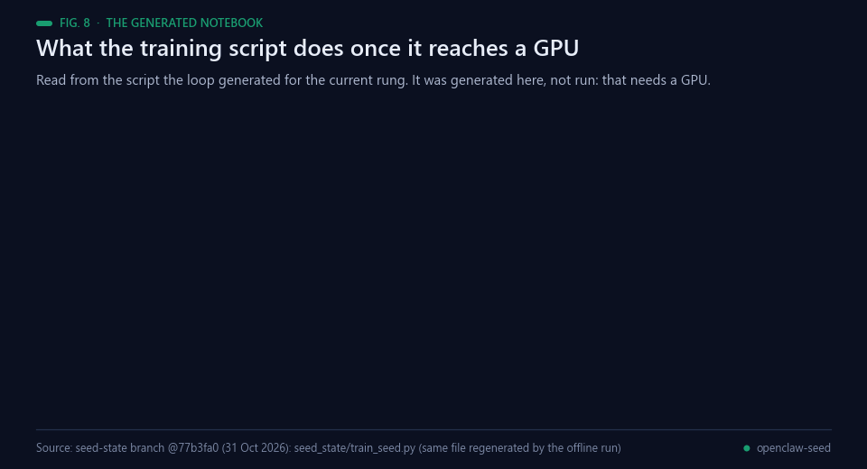<br><sub>Fig. 8 — What the generated notebook does on a GPU. Generated here, not run.</sub></p>

### Opción B: Google Colab
1. Abre https://colab.research.google.com
2. Sube el notebook `SEED_Training_Kaggle.ipynb`
3. Cambia runtime a GPU
4. Ejecuta — el notebook funciona igual en Colab

### Opción C: HuggingFace AutoTrain
El sistema ya genera configuraciones AutoTrain automáticamente.

## 📊 Progresión del Modelo (Automática)

<p align="center">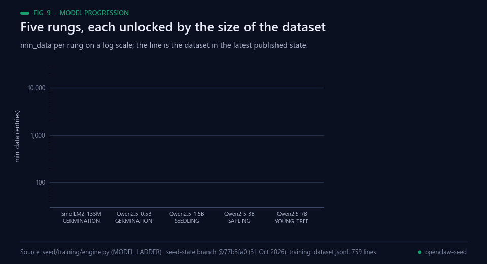<br><sub>Fig. 9 — The model ladder in seed/training/engine.py and the dataset size in the published state.</sub></p>

| Stage | Modelo | Datos Necesarios | Estado |
|-------|--------|-----------------|--------|
| GERMINATION | SmolLM2-135M | 100 ✅ (tenemos 442) | **LISTO PARA ENTRENAR** |
| SEEDLING | Qwen2.5-0.5B | 500 | ~2 ciclos más |
| SAPLING | Qwen2.5-1.5B | 2,000 | ~1 semana |
| YOUNG_TREE | Qwen2.5-3B | 5,000 | ~2 semanas |
| MATURE | Qwen2.5-7B | 10,000 | ~1 mes |

## 🔐 Seguridad

<p align="center">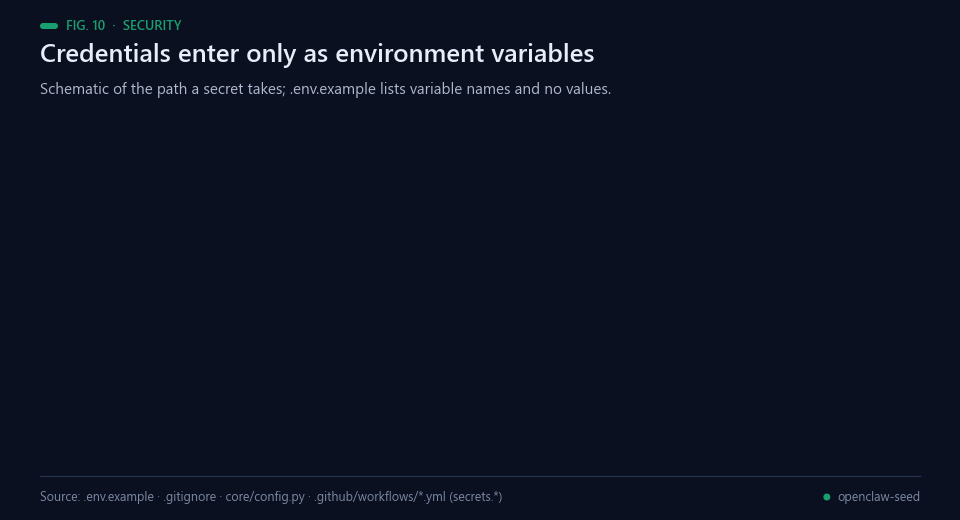<br><sub>Fig. 10 — Where credentials enter. Schematic; no value is shown.</sub></p>

- ✅ Zero secrets in code (todo via GitHub Secrets + HF Space Secrets)
- ⚠️ **ROTA ESTAS CLAVES** (compartidas en texto plano):
  - GitHub token
  - Email passwords
  - API keys

## 🧬 Arquitectura del Código

<p align="center">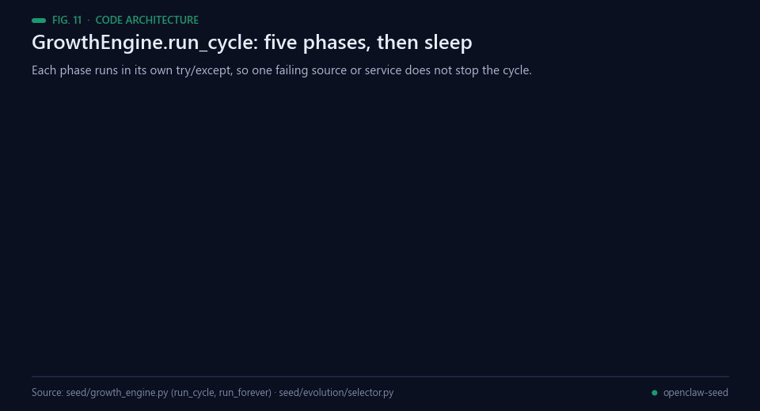<br><sub>Fig. 11 — GrowthEngine.run_cycle, from seed/growth_engine.py.</sub></p>

```
openclaw-agent/
├── core/                    # Agente social autónomo
│   ├── agent.py            # Ciclo principal: research → post → engage → collab
│   ├── llm.py              # Multi-provider LLM (NVIDIA + fallbacks)
│   ├── config.py           # Configuración desde env vars
│   └── strategy.py         # Auto-análisis y mejora
├── seed/                    # 🌱 SEED — Sistema de crecimiento
│   ├── growth_engine.py    # Orquestador maestro (harvest → train → evaluate → evolve)
│   ├── data/harvester.py   # Cosechador autónomo de datos
│   ├── training/engine.py  # Motor de entrenamiento LoRA
│   ├── evaluation/evaluator.py  # Benchmarks automáticos
│   └── evolution/selector.py    # Selección natural de modelos
├── research/               # Fuentes de investigación
│   ├── arxiv_fetcher.py    # ArXiv real papers
│   └── web_scanner.py      # Semantic Scholar, HF models
├── social/                  # Plataformas sociales
│   └── moltbook.py         # Moltbook API client
├── seed_data/              # Datos de entrenamiento (crece solo)
│   ├── bootstrap_knowledge.jsonl  # Conocimiento semilla (23 entries)
│   ├── arxiv_training.jsonl       # Papers cosechados (123 entries)
│   ├── own_research.jsonl         # Nuestros repos (62 entries)
│   └── training_dataset.jsonl     # Dataset combinado (442 entries)
├── .github/workflows/
│   ├── agent.yml           # Agente social cada 4h
│   └── seed_growth.yml     # Crecimiento SEED cada 6h
├── app.py                  # Dashboard Gradio (HF Space)
├── Dockerfile              # Docker para HF Space
└── requirements.txt
```

## 🌍 La Visión

<p align="center">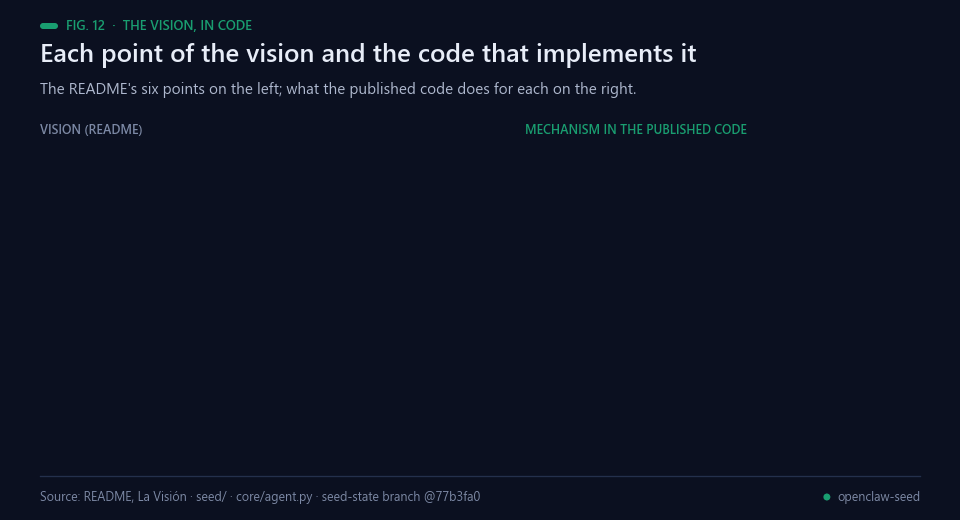<br><sub>Fig. 12 — The vision mapped to the published code.</sub></p>

Este sistema es literalmente **una semilla de inteligencia artificial plantada en internet**:

1. **Nace pequeña** (135M parámetros) pero con conocimiento semilla sobre CHIMERA, NEBULA, y toda tu investigación
2. **Se alimenta sola** cosechando papers de ArXiv, Semantic Scholar, y tus repos
3. **Crece entrenándose** con LoRA en GPU gratis (Kaggle 30h/semana)
4. **Evoluciona** por selección natural — solo sobreviven los mejores modelos
5. **Se reproduce** publicando investigación y atrayendo colaboradores
6. **Escala** automáticamente a modelos más grandes cuando tiene suficientes datos

**No es un chatbot. Es un organismo digital que investiga, aprende, crece y busca colaboradores para la AGI.**

---
*Created by Francisco Angulo de Lafuente*
*Advanced AI Systems Laboratory, Madrid, Spain*
*https://github.com/Agnuxo1 | https://arxiv.org/search/cs?searchtype=author&query=de+Lafuente,+F+A*

---

## Real-world applications

<p align="center">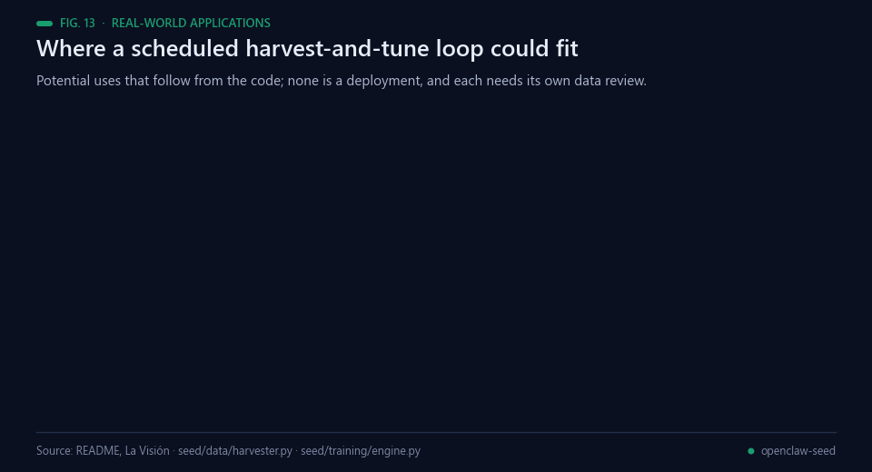<br><sub>Fig. 13 — Potential uses that follow from the code. None is a deployment.</sub></p>

These are potential uses of the published code, not results; each would need its own data review and, before any
model is promoted, a held-out evaluation.

- **A living literature corpus.** A lab could keep an instruction dataset of new papers in its field, deduplicated
  by title and versioned in a Hub dataset, from the same fixed queries the harvester runs every cycle.
- **Small domain assistants.** A sub-billion model tuned on a group's own papers and repositories would be cheap
  enough to serve on modest hardware; LoRA [[1](#ref-1)] and the 4-bit route of QLoRA [[2](#ref-2)] keep the tuning on
  one GPU.
- **A curriculum by data size.** The ladder only moves to a larger base model when the dataset reaches the rung's
  `min_data`, a simple guard against tuning a model that is too large for the data it has.
- **A free-tier MLOps template.** Cron workflows, state kept in git branches and notebooks generated for free GPU
  quotas form a pattern small teams could reuse for other periodic tuning jobs.
- **Research monitoring.** The harvester alone can follow fixed queries across arXiv and Semantic Scholar
  [[13](#ref-13)] and keep only what is new.
- **A testbed for self-training.** The loop is a place to measure how repeated tuning on harvested and generated
  text changes a small model, which is exactly where model collapse [[14](#ref-14)] and forgetting [[15](#ref-15)] would show.

## Possible improvements

<p align="center">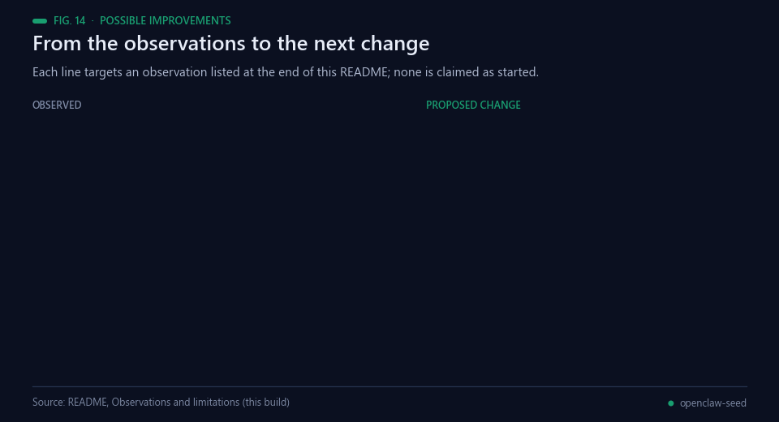<br><sub>Fig. 14 — Each line targets an observation listed in Observations and limitations. None is claimed as started.</sub></p>

- **Count each entry once.** `get_dataset_size()` adds `training_dataset.jsonl` to the source files it was built
  from, so the published state reports 1518 entries for a 759-line training file. Skipping the combined file when counting,
  as `export_for_training()` already does, would make the readiness gate read the real size.
- **Close the loop after training.** Nothing in this repository calls `TrainingEngine.record_training_result()`,
  so the evaluation and selection phases never see a model. Reading the `training_report.json` that the generated
  script writes back from the Hub, and recording it, would let them run.
- **Keep the harvest productive.** The last published harvest added 0 entries from every source. Rotating or
  widening the ten fixed arXiv queries, and logging the yield per query, would show when a topic is exhausted.
- **Fail loudly.** In the latest published agent cycle every LLM call returned HTTP 410 and Moltbook returned 401,
  and the agent fell back to a template and posted nothing. A health check that fails the workflow on provider
  errors would surface this instead of logging it.
- **Guard the self-training.** Before a tuned model replaces the previous one, a fixed held-out evaluation set
  tracked across rungs would detect collapse [[14](#ref-14)] or forgetting [[15](#ref-15)]; the keyword benchmark in
  `seed/evaluation/evaluator.py` is a starting point.

## Future work

<p align="center">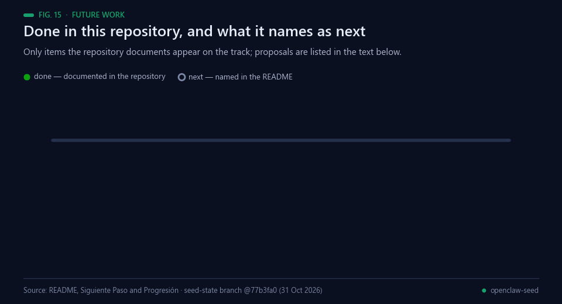<br><sub>Fig. 15 — Only items this repository documents appear on the track.</sub></p>

Documented in this repository:

1. The growth engine in `seed/`, with a five-rung model ladder from SmolLM2-135M to Qwen2.5-7B.
2. Scheduled workflows for the social agent, the growth cycle and the weekly training preparation.
3. 1318 growth cycles and 759 training entries in the published state ([`seed-state`](https://github.com/Agnuxo1/openclaw-seed/tree/seed-state) branch, 31 Oct 2026).
4. The second rung (Qwen2.5-0.5B-Instruct) selected, with `ready_to_train: true`.

Named in the README as next: the first GPU training run (Kaggle, Colab or AutoTrain, section
[Siguiente Paso](#-siguiente-paso-entrenamiento-con-gpu)), then the larger rungs of the progression table.

**Proposed next steps (not commitments).** These are suggestions from this README build, not the author's
published plan: count each dataset entry once; record training results so that evaluation and selection can run;
a held-out evaluation set reported per rung; and a workflow that fails visibly when an LLM or social provider
rejects its calls.

## Observations and limitations

<p align="center">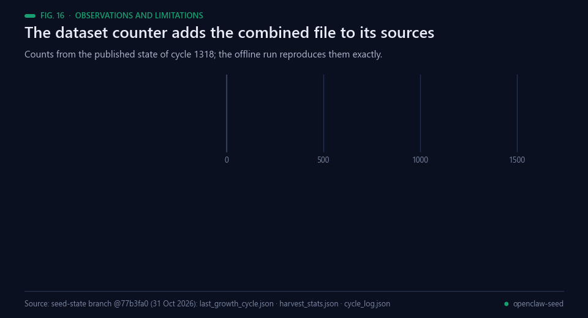<br><sub>Fig. 16 — The dataset counter and the evaluation phase in the published state of cycle 1318.</sub></p>

Found while building this README from the published files; the original text above is unchanged. The numbers come
from the state the workflows publish ([`seed-state`](https://github.com/Agnuxo1/openclaw-seed/tree/seed-state) branch @77b3fa0 and the
[`state`](https://github.com/Agnuxo1/openclaw-seed/tree/state) branch @25b8534, both 31 Oct 2026) and from the
offline run in Fig. 7, which reproduces the seed-state counts exactly.

- **Double count.** `get_dataset_size()` counts `training_dataset.jsonl` together with the files it is built from:
  the 759 entries (435 arXiv, 223 own repositories, 78 Semantic Scholar, 23 bootstrap) are reported as 1518.
  The readiness gate in `GrowthEngine.train()` uses the doubled total, while the rung choice counts the combined
  file; both clear 500 today. The README's 442 is twice 221, the sum of its own 23 + 123 + 13 + 62, which is
  consistent with the same double count.
- **Duplicated training rows.** The generated script loads every `*.jsonl` it finds, and the upload sends every
  `*.jsonl` in `seed_data/`; where the combined file and its sources sit side by side, each entry would be loaded
  twice.
- **No training recorded.** `record_training_result()` is never called in this repository, the published state has
  no `growth_log.json`, `last_evaluation` is `null` and the evaluation phase reports "No models to evaluate yet".
  The stage reflects the size of the dataset, not a trained model.
- **Harvest saturation.** The last published harvest (`harvest_stats.json`) added 0 entries from arXiv, agent logs,
  Semantic Scholar and GitHub.
- **Stage names differ.** The README table calls Qwen2.5-0.5B `SEEDLING` and Qwen2.5-7B `MATURE`; `engine.py`
  labels both 135M and 0.5B `GERMINATION`, 1.5B `SEEDLING`, 3B `SAPLING` and 7B `YOUNG_TREE`, and
  `seed/__init__.py` lists a third mapping. The figures follow `engine.py`.
- **Earlier snapshot.** The counts in the README tables (442 entries, 123 arXiv papers, 13 Semantic Scholar papers,
  62 repositories) are an earlier state; the published state now holds the counts above.

<p align="center">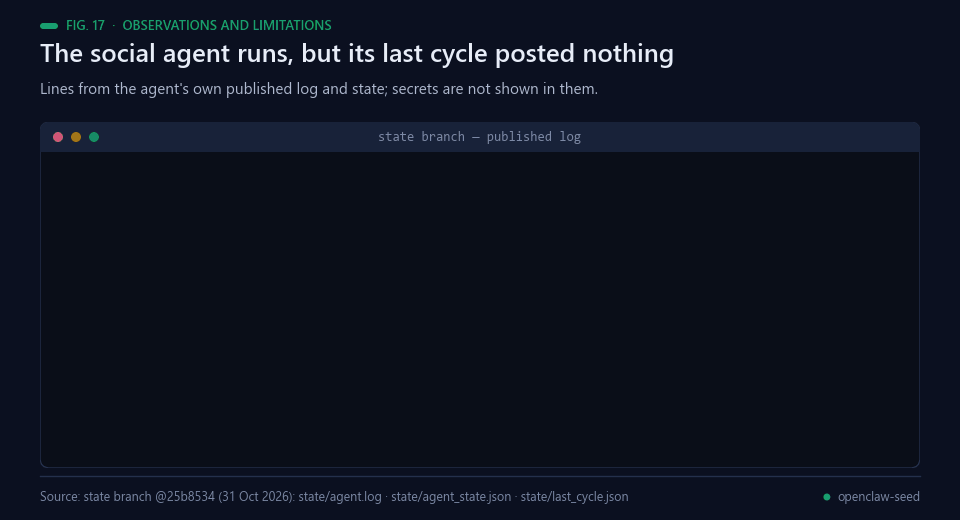<br><sub>Fig. 17 — The social agent's own published log for cycle 683.</sub></p>

- **Social agent.** The published agent state shows 683 cycles, `posts_created: 0` and `engagement_count: 0`.
  In its latest log every NVIDIA call returned HTTP 410 and Moltbook returned HTTP 401 "Invalid API key", so the
  post and collaboration tasks failed; the README table marks these services as active.
- **Not checked here.** The HF Space status, the GitHub Actions success ratio (6/8), the number of files in the
  Hub dataset (12) and the 57 repositories are not recorded in any file of this repository. The evaluator's ten
  prompts call the Hugging Face Inference API and were not run.

## 🧩 P2PCLAW Ecosystem

<p align="center">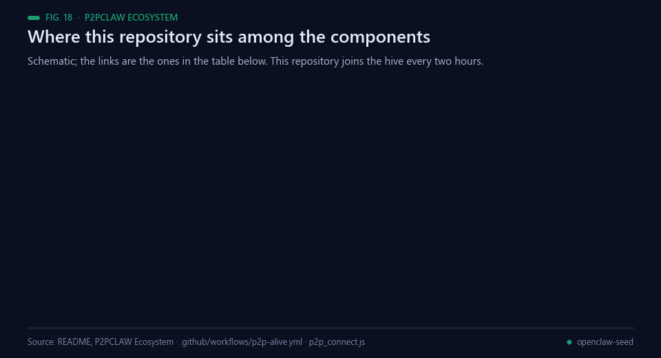<br><sub>Fig. 18 — Where this repository sits in P2PCLAW. Schematic.</sub></p>

This project is part of **P2PCLAW** — a distributed AI research network with production-grade benchmarking, agent tooling, and model distribution.

| Component | Role | Link |
|-----------|------|------|
| **OpenCLAW-P2P** | Core protocol · Lean 4 proofs · Papers | [github.com/Agnuxo1/OpenCLAW-P2P](https://github.com/Agnuxo1/OpenCLAW-P2P) |
| **BenchClaw** | 17-judge agent benchmarking | [github.com/Agnuxo1/benchclaw](https://github.com/Agnuxo1/benchclaw) |
| **EnigmAgent** | Local encrypted vault for credentials | [github.com/Agnuxo1/EnigmAgent](https://github.com/Agnuxo1/EnigmAgent) |
| **AgentBoot** | Bare-metal OS installer | [github.com/Agnuxo1/AgentBoot](https://github.com/Agnuxo1/AgentBoot) |
| **CAJAL** | 4B research LLM for papers | [huggingface.co/Agnuxo/CAJAL-4B-P2PCLAW](https://huggingface.co/Agnuxo/CAJAL-4B-P2PCLAW) |

🌐 **Main website:** [https://www.p2pclaw.com/](https://www.p2pclaw.com/)
📄 **Paper:** [arXiv:2604.19792](https://arxiv.org/abs/2604.19792)

---

## 💝 Support

If this tool is useful to you:
- ⭐ **Star the repo** — it's how the ecosystem discovers tools
- 🐛 **Open an issue** — every real use case sharpens the project
- 💰 **Sponsor:** [github.com/sponsors/Agnuxo1](https://github.com/sponsors/Agnuxo1)

Built by **Francisco Angulo de Lafuente** — independent researcher with 35+ years in software.

## Citation and Reuse

Cite this software using [CITATION.cff](CITATION.cff). The repository retains its existing Apache-2.0 license in [LICENSE](LICENSE); keep the license and applicable notices with redistributed copies or substantial portions. For reproducible results or corrections, credit Francisco Angulo de Lafuente (ORCID: https://orcid.org/0009-0001-1634-7063).

## Bibliography

1. <a id="ref-1"></a>Hu, E. J., Shen, Y., Wallis, P., et al. (2021). LoRA: Low-Rank Adaptation of Large Language Models. *arXiv* 2106.09685. https://arxiv.org/abs/2106.09685
2. <a id="ref-2"></a>Dettmers, T., Pagnoni, A., Holtzman, A., & Zettlemoyer, L. (2023). QLoRA: Efficient Finetuning of Quantized LLMs. *arXiv* 2305.14314. https://arxiv.org/abs/2305.14314
3. <a id="ref-3"></a>Wang, Y., Kordi, Y., Mishra, S., et al. (2022). Self-Instruct: Aligning Language Models with Self-Generated Instructions. *arXiv* 2212.10560. https://arxiv.org/abs/2212.10560
4. <a id="ref-4"></a>Taori, R., Gulrajani, I., Zhang, T., Dubois, Y., Li, X., Guestrin, C., Liang, P., & Hashimoto, T. B. (2023). *Alpaca: A strong, replicable instruction-following model*. Stanford Center for Research on Foundation Models. https://crfm.stanford.edu/2023/03/13/alpaca.html
5. <a id="ref-5"></a>Allal, L. B., Lozhkov, A., Bakouch, E., et al. (2025). SmolLM2: When Smol Goes Big -- Data-Centric Training of a Small Language Model. *arXiv* 2502.02737. https://arxiv.org/abs/2502.02737
6. <a id="ref-6"></a>Qwen Team: Yang, A., Yang, B., Zhang, B., et al. (2024). Qwen2.5 Technical Report. *arXiv* 2412.15115. https://arxiv.org/abs/2412.15115
7. <a id="ref-7"></a>Wolf, T., Debut, L., Sanh, V., et al. (2020). Transformers: State-of-the-Art Natural Language Processing. *Proceedings of the 2020 Conference on Empirical Methods in Natural Language Processing: System Demonstrations*, 38–45. https://doi.org/10.18653/v1/2020.emnlp-demos.6
8. <a id="ref-8"></a>Jaderberg, M., Dalibard, V., Osindero, S., et al. (2017). Population Based Training of Neural Networks. *arXiv* 1711.09846. https://arxiv.org/abs/1711.09846
9. <a id="ref-9"></a>Zelikman, E., Wu, Y., Mu, J., & Goodman, N. D. (2022). STaR: Bootstrapping Reasoning With Reasoning. *arXiv* 2203.14465. https://arxiv.org/abs/2203.14465
10. <a id="ref-10"></a>Huang, J., Gu, S. S., Hou, L., et al. (2022). Large Language Models Can Self-Improve. *arXiv* 2210.11610. https://arxiv.org/abs/2210.11610
11. <a id="ref-11"></a>Wang, G., Xie, Y., Jiang, Y., et al. (2023). Voyager: An Open-Ended Embodied Agent with Large Language Models. *arXiv* 2305.16291. https://arxiv.org/abs/2305.16291
12. <a id="ref-12"></a>Lu, C., Lu, C., Lange, R. T., et al. (2024). The AI Scientist: Towards Fully Automated Open-Ended Scientific Discovery. *arXiv* 2408.06292. https://arxiv.org/abs/2408.06292
13. <a id="ref-13"></a>Kinney, R., Anastasiades, C., Authur, R., et al. (2023). The Semantic Scholar Open Data Platform. *arXiv* 2301.10140. https://arxiv.org/abs/2301.10140
14. <a id="ref-14"></a>Shumailov, I., Shumaylov, Z., Zhao, Y., et al. (2024). AI models collapse when trained on recursively generated data. *Nature*, 631(8022), 755–759. https://doi.org/10.1038/s41586-024-07566-y
15. <a id="ref-15"></a>Kirkpatrick, J., Pascanu, R., Rabinowitz, N., et al. (2017). Overcoming catastrophic forgetting in neural networks. *Proceedings of the National Academy of Sciences*, 114(13), 3521–3526. https://doi.org/10.1073/pnas.1611835114
16. <a id="ref-16"></a>Angulo de Lafuente, F., Sharma, T., Veselov, V., et al. (2026). OpenCLAW-P2P v7.0-P2PCLAW: Resilient Multi-Layer Persistence, Live Reference Verification, and Production-Scale Evaluation of Decentralized AI Peer Review. *arXiv* 2604.19792. https://arxiv.org/abs/2604.19792

---

<div align="center">
<sub>Animated figures added for the P2PCLAW portfolio · every number in them comes from a file of this repository,
its published state branches, or the real offline run named in the figure footer ·
<a href="#-openclaw-seed--complete-autonomous-ai-ecosystem">back to top ↑</a></sub>
</div>
